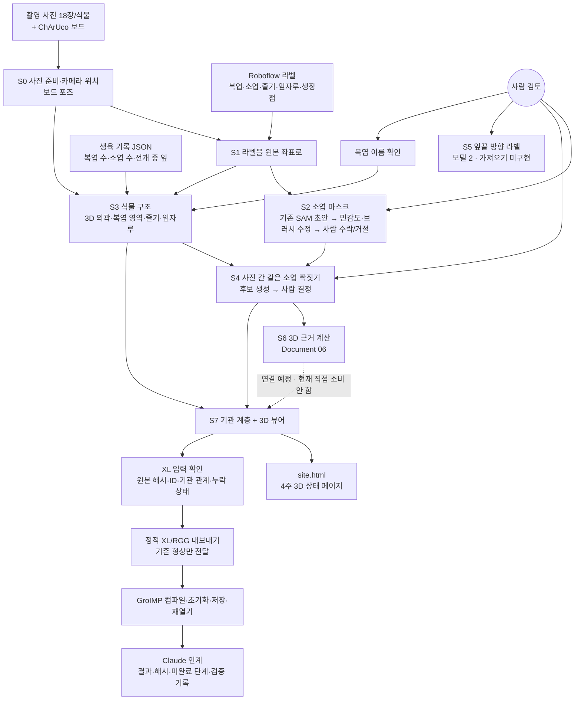
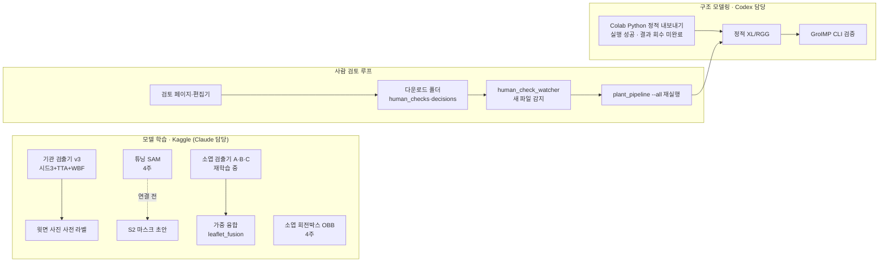

# 토마토 3D 파이프라인 전체 흐름 (2026-09-28)

기준 실행: `build/pipeline_20260928_122948/` (dwt_04 줄기 수정 반영).
사용자 문제·해결 기록: `handoff/CLAUDE_USER_PROPOSED_FIXES_2026-09-28.md` E1–E18.
XL 연결 결과: `build/xl_handoff_20260928_122948/` (4개체 실제 GroIMP 컴파일·초기화·저장·재열기 통과).
모든 수치는 **진단용**입니다. 카메라 위치가 1 px 기준을 통과하지 못해 실측·광량(PPFD) 계산 입력으로는 쓸 수 없습니다.

실행 명령 (프로젝트 루트에서):

```
python -X utf8 -m tools.plant_pipeline --all
```

실행할 때마다 `build/pipeline_<시각>/`이 새로 생깁니다. 안에는 식물별 폴더, `STATUS.md`(단계별 결과), `HUMAN_TASKS.md`(사람이 할 일), `site.html`(4주 3D 상태 페이지)가 들어갑니다. 입력이 없으면 단계가 값을 지어내지 않고 "사람 작업 대기"나 "불가"로 멈추며, 다음 단계는 있는 것만으로 계속 진행합니다.

---

## 1. 한눈에 보기



글로 보면: **사진·보드 → (S0) 카메라 위치 → (S1) 라벨 → (S2) 소엽 마스크 → (S3) 3D 외곽과 복엽·줄기 → (S4) 사진 간 소엽 짝짓기 → (S6) 3D 근거 → (S7) 계층·3D 뷰어 → XL 내보내기**입니다.

---

## 2. 단계별 상세

| 단계 | 하는 일 | 주 입력 | 도구 | 출력 | 사람 개입 |
|---|---|---|---|---|---|
| **S0** 세션 | 사진 정리, 해시 확인, ChArUco 보드로 카메라 위치 계산 | `tomato_photos_organized_/`, 매핑 CSV, 내부 파라미터 | `tools.import_organized_capture` | `build/new_captures_*/<식물>/capture.json` | 없음 (있으면 재사용) |
| **S1** 라벨 | Roboflow 640px 라벨을 원본 3024px 좌표로 변환, 사진별 검증 | Roboflow COCO | `tools.roboflow_session_import` | `labels/seed_with_imports.backup.json` | 라벨 자체는 사람이 Roboflow에서 작성 |
| **S2** 마스크 | 기존 소엽별 SAM 초안 → 민감도·포함/제외점·브러시 수정 → 개별 수락/거절(+이유). 재실행이 새 모델 추론을 자동 수행하는 것은 아님 | S1 라벨, 기존 배치 | `tools.leaflet_mask_batch`, 편집기 포트 8821–8824 | 수락 마스크 export | **수락/거절, 가림·거절 이유** |
| **S3** 구조 | 보드 포즈 사진으로 3D 외곽(visual hull) 깎기 → 복엽 박스 투표로 복엽 영역 → 이름 제안(아래→위 L01…) → 줄기 축 → 잎자루 | S0, S1, 생육 JSON | `tools.plant_structure` | `structure/structure.json`, `hull_voxels.csv`, 오버레이 | **복엽 이름 확인** |
| **S4** 짝짓기 | 저장된 사람 결정을 소엽 ID로 반영 → 새 "같은 소엽" 후보와 보임 정도 질문 생성 | S2 마스크, S3, 결정 파일 | `tools.cross_view_identity_import`, `tools.cross_view_candidates` | `identities/`, `candidates/review.html` | **같은 소엽 여부 결정** |
| **S5** 방향 | 잎끝 방향(side_left/side_right/front/back) 모델 2 라벨 가져오기 | 방향 라벨 export | (export 형식 확인 후 연결) | — | **방향 라벨 작성** |
| **S6** 근거 | 확인된 소엽 ID로 3D 근거(지지 칸) 진단 계산 | S4 확인 ID | `tools.instance_workflow` | 진단 결과 | 없음 (dwt_01은 보호장치 대기) |
| **S7** 계층 | 기관 계층, 자동 제안 소엽, 3D 뷰어. 현재 S6 결과를 직접 읽지 않음 | S3, S4, 수락 마스크 | `tools.plant_hierarchy`, `tools.plant_site` | `hierarchy/viewer.html`, `site.html` | 관계 제안은 별도 확인 |
| **XL 인계** 선택 단계 | 고정된 실행의 입력·해시 확인 → 기존 기관과 형상 내보내기 → 선택적 GroIMP 실행 검증 | S7, 해당 실행의 구조·라벨·상태 | `tools.plant_xl_handoff` → 기존 exporter/verifier | `Model.rgg`, 기관·관계·좌표 CSV, `handoff.json`, `CLAUDE_README.md` | GUI에서 시각적 검토는 별도 |

### S3 줄기 맞춤 (09-28 변경)
1. **광선 맞춤(기본):** 사진 2장 이상의 주줄기 윤곽 중심선으로 3D 직선을 맞춥니다. 두 사진이 함께 본 구간이 있어야 합니다.
2. **외곽 추적(대체):** 1이 실패하면 윤곽 안에 투영되는 3D 외곽 복셀을 바닥부터 위로 따라가 아래 줄기만 맞춥니다. 이 복셀은 복엽 영역에서 빼고 나서 이름을 정합니다. 굵기는 계산하지 않습니다.
   - dwt_04가 이 경우입니다. 사진 26은 아래 줄기, 사진 28은 위쪽 조각만 라벨돼 있어 겹치는 구간이 없었고, 줄기가 L02 영역에 섞여 있었습니다.

---

## 3. 파이프라인 바깥 흐름



- **사람 검토 루프:** 검토 페이지에서 저장한 파일이 다운로드 폴더에 생기면 `tools/human_check_watcher.py`가 감지해 파이프라인을 다시 돌립니다.
- **업로드 분담:** Kaggle은 Claude, Colab은 Codex가 올리고 결과를 받습니다. 결과는 서로 확인할 수 있습니다.
- **XL 관련 파일은 Codex 작업이 끝날 때까지 수정 금지입니다.**

---

## 4. 현재 상태 (pipeline_20260928_122948) — 최신 값은 12절

| 항목 | dwt_01 | dwt_02 | dwt_03 | dwt_04 |
|---|---|---|---|---|
| 사진 / 보드 포즈 | 18 / 6장 | 18 / 8장 | 18 / 5장 | 17 / 3장 |
| 1 px 기준 통과 | 0 | 0 | 0 | 0 |
| 라벨 | 388 | 388 | 432 | 534 |
| 마스크 수락 / 거절 | 268 / 24 | 246 / 39 | 278 / 18 | 364 / 44 |
| 3D 외곽 (사진 수) | 150.3 cm³ (3) | 69.9 cm³ (6) | 124.5 cm³ (3) | 171.5 cm³ (3) |
| 복엽 영역 | L01–L04 | L01–L03 + 영역4 | L01–L04 | L01–L04 + 조각 1 |
| 줄기 | 광선 맞춤 | 광선 맞춤 | 광선 맞춤 | **외곽 추적(아래 줄기)** |
| 잎자루 | 2 | 2 | 2 | 1 |
| 확인된 소엽 (S4) | 7 | 0 | 0 | 0 |
| 짝짓기 질문 | 12 | 133 | 80 | 59 |
| S6 | 오류(보호장치) | 대기 | 대기 | 대기 |
| 자동 제안 소엽 (S7) | — | 14 | 5 | 2 |

- 3D 보기: `build/pipeline_20260928_122948/<식물>/hierarchy/viewer.html`, 4주 전체는 `site.html`입니다.
- dwt_01 S6 오류: `Prepared import source changed; crop validation is required before reimport`. 생육 JSON이 수정돼 해시가 바뀐 것으로, Codex 판단을 기다리는 중입니다.

---

## 5. 사람이 할 일 (16개, 우선순위 순) — 최신 목록은 12절

| 순서 | 작업 | 개수 | 위치 |
|---|---|---|---|
| 1–4 | 사진 간 같은 소엽 짝짓기 | dwt_01 12 · 02 133 · 03 80 · 04 59 | `<식물>/candidates/review.html` |
| 5, 7, 9, 11 | 거절 마스크에 이유 붙이기 (가려짐/복수 박스/잎 못 담음/오탐) | 24 · 39 · 18 · 44 | `build/reject_reasons_20260927/review.html` |
| 6, 8, 10, 12 | 잎끝 방향 라벨 (모델 2) | 4주 | 규칙: 잎끝이 카메라 쪽이면 front, 반대면 back |
| 13–16 | 복엽 이름 제안 확인 (아래→위) | 4주 | `<식물>/structure/overlays` |

저장된 파일은 다운로드 폴더에 그대로 두면 감시기가 다음 실행에 반영합니다.

---

## 6. 모델 자산

| 모델 | 용도 | 성능 (다른 식물 기준) | 위치 |
|---|---|---|---|
| 기관 검출기 v3 (yolo11s-seg ×3 시드) | 복엽·소엽·줄기 박스, 사전 라벨 | 소엽 AP50 0.691 | `build/organ_detector_20260925/kout_v3/final_all_s{0,1,2}.pt` |
| SAM 2.1 tiny 튜닝 (4주) | 소엽 마스크 | IoU 중앙값 0.89–0.91 | `build/leaflets4_20260927/kout_sam/sam2_tiny_decoder_tuned_4plants.pt` |
| 소엽 회전박스 OBB (4주) | 소엽 방향축 | mAP50 0.81–0.86, 축 오차 9–13° | `build/leaflets4_20260927/kout_obb/leaflet_obb_4plants.pt` |
| 소엽 검출기 A·B·C | 소엽 전용 검출 + 가중 융합 | 재학습 중 (조기종료 문제 수정) | `build/leaflet_detect_20260927/` |

S2 마스크 초안은 dwt_01·02가 기본 SAM(09-22 배치), dwt_03·04가 2주 기준 튜닝 SAM(`build/leaflet_pieces_20260925/`, 09-25 배치)으로 만들어졌습니다. 4주 튜닝 SAM은 아직 파이프라인에 연결되지 않았습니다.

---

## 7. 정해진 규칙

- **보드 포즈가 기준입니다.** ChArUco로 포즈를 구할 수 있으면 그것으로 모델링하고, SfM은 참고용입니다. SfM은 4주 모두 보드와 정렬에 실패했습니다.
- **복엽 이름은 아래→위입니다.** L01이 가장 아래, 전개 중인 잎이 맨 위(마지막 번호)입니다.
- **값을 지어내지 않습니다.** 없는 입력은 사람 작업으로 넘기고, 수치는 모두 `validated_metric=false`, `suitable_for_ppfd=false`입니다.
- **XL 관련 파일은 Codex 완료 전까지 수정 금지입니다.**

## 8. 다음 단계

1. 사람 검토를 진행해 S4의 동일성·가림 정보를 채웁니다. S6 입력 보호장치와 S6→S7 연결 문제는 별도 코드 수정이 필요하므로, 검토만으로 모두 해결되지는 않습니다.
2. 소엽 검출기 A·B·C 재학습이 끝나면 가중 융합으로 평가하고, 좋으면 사전 라벨에 씁니다.
3. 이번 실행의 4개체는 `build/xl_handoff_20260928_122948/`에 XL로 내보내고 GroIMP 실행 검증까지 완료했습니다. dwt_04는 `hull_trunk` 출처와 굵기 미상 상태를 유지합니다.
4. 이후 순서(Codex 문서 기준): 단순 광원 확인 → 실측 PPFD 비교 → 캐노피 배치입니다.

## 9. 사용자 문제·해결 방법을 처리 단계에 적용

| 인계 항목 | 사용자 문제 | 사용하는 방법·단계 | 완료 범위·남은 점 |
|---|---|---|---|
| E1 | 휴대폰 사진의 깊이·실제 크기 | S0 보정·ChArUco 자세 + 같은 물리점 삼각측량 | 자세 계산과 정확도 통과는 별개. 기준 미통과 유지 |
| E2 | 겹친 소엽 분리 | S2 개별 bbox → SAM 후보 → 사람 확정 | 복엽 마스크를 소엽 여러 장으로 간주하지 않음 |
| E3 | 잎자루에 주변 소엽 혼입 | 포함·제외점, 별도 소엽 ID, 윤곽 수정 | 작은 실제 잎을 노이즈로 자동 삭제하지 않음 |
| E4 | 민감도 선택 어려움 | 저장 점수 기반 미리보기, 값 20에서 시작·비교·명시적 저장 | 값 20은 사용자 선호이며 보편적 정답 아님 |
| E5 | 잘못 그린 라벨 수정 | 선택·수정·삭제·브러시 칠하기/지우기·되돌리기 | 원본 픽셀 좌표·수정 이력 유지 |
| E6 | 다른 사진의 같은 소엽 연결 | S4 사진 관측 ID / 실제 소엽 ID / 복엽 ID / 물리점 ID 분리 | 미확정 관계는 후보로 유지 |
| E7 | ID 분리 후 이전 출처가 남음 | 연결·분리 때 후보·출처 이동, 양방향 점 연결 모호성 검사 | 09-20 수정 기록 있음. 소엽 분리와 점 대응 확정은 별개 |
| E8 | 특징점 수작업 부담 | 자동 후보·기하 검사 → 사람이 같은 물리점인지 수락 | bbox 모서리·독립 윤곽 번호를 대응점으로 사용 금지 |
| E9 | 특징점 전 XYZ 범위 확인 | 여러 뷰 bbox의 공간 교차, 가림 상태별 근거 구분 | 상자는 위치 탐색용. 잎 표면·PPFD 차폐체 아님 |
| E10 | 전체 식물 모양이 안 보임 | S3 실루엣 교차로 visual hull, S7 층별 표시 | 공간 덩어리의 부피를 잎 조직량으로 해석하지 않음 |
| E11 | 복엽 소속·검출 수와 JSON 불일치 | 성장 JSON과 관측/확정/제안 수 비교, 복엽 소속 사람 확인 | 아래→위 L01 규칙. 개수 맞추기용 기관 생성 금지 |
| E12 | 측면 보드 검출 실패 | ChArUco 기준 유지, 별도 진단 특징점 자세 | SfM 정렬 실패. 보드 자세를 대체하지 않음 |
| E13 | 떨어진 3D 조각 | S3 최대 연결 성분 필터 | 실제 작은 기관 손실 가능성 있는 보조 규칙 |
| E14 | L02에 줄기가 포함됨 | 기본 광선 맞춤 실패 시 아래 줄기 외곽 추적 → 복엽 영역에서 제외 | 새 실행에 반영. 4번 잎자루는 한 뷰 기반, 두 뷰 길이 미상 |
| E15 | 자동 검출 과다 | 학습곡선 점검·조기 종료 수정, OBB/SAM 별도 평가 | 재학습·모델 연결 상태는 §6 및 최신 Claude 로그 확인 |
| E16 | GroIMP로 정보 전달 | 고정 실행 → XL 인계 도구 → 기존 exporter → GroIMP 검증 | 기관·관계·출처·단위 전달, 표면 없는 잎은 점 표시 |
| E17 | CPU 부족 시 Colab | 입력 ZIP → Colab 정적 내보내기 → 검증 후 로컬 회수 | 정적 내보내기만 실행 성공. 무거운 복원 자동 분산은 미구현 |
| E18 | 카메라·보드·입력 변경 오류 | 렌즈 계약, 보드 출처, 해시 검사, 소수 둘째 자리까지 버림 비교 | dwt_01/02 성장 JSON 변경과 사진 변경을 구분할 후속 수정 필요 |

S2 완료 판정은 이번 연결 작업에서 보강했습니다. **미생성·생성 실패·보류 등 미완료 항목이 있으면 완료로 표시하지 않습니다.** 기존 실행 스냅샷의 상태는 덮어쓰지 않았습니다.

## 10. XL까지 실행하는 방법

프로젝트 루트에서 실행합니다. 출력 폴더는 매번 새 이름을 사용합니다.

### 기존 실행을 그대로 XL로 연결 (현재 권장)

```powershell
python -X utf8 -m tools.plant_xl_handoff --run build/pipeline_20260928_122948 --out build/xl_handoff_NEW --core ../groimp/core.jar
```

이 명령은 사진 재복원·학습·추론을 하지 않고 기존 결과만 읽습니다. `--core`를 생략하면 파일 생성만 하며 실제 GroIMP 검증 완료로 표시하지 않습니다. `--plant dwt_01`처럼 개체를 지정할 수도 있습니다.

### 이후 사람이 검토를 마친 뒤 전체 재계산과 XL 연결

```powershell
python -X utf8 -m tools.plant_pipeline --all --xl --groimp-core ../groimp/core.jar
```

기존 S0–S7을 실행한 다음, 같은 실행 폴더의 `xl_handoff/`에 정적 XL 결과를 만듭니다. S6 실패가 있어도 보유한 구조는 내보낼 수 있으며, 실패 상태와 사람 작업 목록을 인계 기록에 그대로 싣습니다. XL 내보내기나 GroIMP 검증 실패는 성공으로 처리하지 않습니다. 기존 `--all`만 사용하는 방법도 유지됩니다.

### 결과 확인

- `<개체>/export/Model.rgg`: GroIMP에서 여는 정적 모델.
- `<개체>/export/organs.csv`, `relationships.csv`, `coordinates.csv`: 원본 ID·관계·m 단위 좌표.
- `<개체>/export/structure_snapshot.json`: `hull_trunk`, 가림·동일성·소속 상태 등 원래 근거.
- `<개체>/verification/verification.json`: 실제 열기·초기화·저장·재열기 결과. `--core` 사용 시 생성.
- `handoff.json`: 입력·출력 해시, 미완료 단계, 사람 작업, 한 뷰 잎자루 등 제한 사항.
- `CLAUDE_README.md`: 클로드가 이어서 읽는 요약과 사용 방법.

`runtime_verified`는 **XL 파일 전달과 GroIMP 실행 검증 통과**를 뜻합니다. 식물 복원 정확도, 전체 잎 표면 완성 또는 PPFD 사용 가능 판정이 아닙니다.

## 11. 클로드 인계와 미완료 항목

첫 진입 문서는 `handoff/CODEX_PIPELINE_TO_XL_2026-09-28.md`입니다. 현재 고정 실행과 XL 출력 경로를 함께 전달하고, 변경된 원본을 옛 실행에 섞지 않습니다.

1. dwt_01 S6 입력 변경을 분류해 안전하게 재준비해야 합니다. 옛 해시를 무조건 교체하거나 보호장치를 삭제하면 안 됩니다.
2. S6의 dwt_03/04 지원 범위와 진단 특징점 자세 연결은 미완료입니다.
3. S7은 아직 S6 결과를 직접 쓰지 않으며 부분 가림 마스크도 교차에 사용합니다. 현재 중심·영역은 옛 방식의 진단 제안으로 표시해야 합니다.
4. S5는 방향 라벨이 있어도 가져오기 연결이 필요합니다. 사람 라벨만으로 자동 완료되지 않습니다.
5. 학습은 Kaggle/Claude, Colab 전송·회수는 Codex 분담을 유지합니다. 새 모델 파일 보유와 실제 적용을 구분합니다.
6. 공유 Claude 아티팩트는 별도 게시물입니다. 로컬 실행·XL 갱신만으로 자동 갱신됐다고 주장하지 않습니다.

이번 인계의 완료 범위는 **사용자 문제·해결 방법을 반영한 실행 흐름 문서와, 기존 구조에서 검증된 정적 XL 출력까지의 연결**입니다. 위 미완료 항목과 PPFD·생장 연구 결과는 별도 후속 작업입니다.


---

## 12. 2026-09-29 갱신: 현재 상태 (`pipeline_20260929_015111`)

사람 검토가 크게 진행됐습니다: 짝짓기 결정 dwt_02 133 · dwt_03 80 · dwt_04 59, 거절 이유 125개 전부, 복엽 이름 4주.

| | dwt_01 | dwt_02 | dwt_03 | dwt_04 |
|---|---|---|---|---|
| 마스크 수락 / 거절 | 268 / 24 | 248 / 37 | 278 / 18 | 369 / 39 |
| 확인된 소엽 (S4) | 7 | 17 | 14 | 11 |
| 3D 영역이 있는 확인 소엽 | 6 | 9 | 4 | 3 |
| 짝짓기 충돌 | 0 | 3 | 2 | 0 |
| 복엽 이름 | 사람 확인 (맨 위 = growing_leaf) | 사람 확인 | 사람 확인 (맨 위 = growing_leaf) | 사람 확인 (L05 = 5복셀 조각) |
| S6 | 보호장치 오류 | 보호장치 오류 | 범위 제한 오류 | 범위 제한 오류 |

S6 두 오류는 Codex 담당(`tools/instance_workflow`)입니다: dwt_01·02는 가져오기 원본 변경 보호장치, dwt_03·04는 "dwt_01/02만" 연구 범위 제한.

**남은 사람 작업 (9개):** 짝짓기 충돌 dwt_02 3 · dwt_03 2 → 보임 정도·짝짓기 검토 18 · 14 · 14 → 잎끝 방향 라벨 4주. 확인 필요: dwt_01·03 맨 위 영역을 growing_leaf로 둘지 생육 기록대로 L04로 할지.

## 13. 사람 검토 페이지 (매 실행마다 자동 생성)

| 페이지 | 위치 | 저장 파일 → 반영 |
|---|---|---|
| 짝짓기·보임 정도 | `<실행>/<식물>/candidates/review.html` | `cross_view_decisions_<식물>_*.json` |
| **짝짓기 충돌** (09-29 신규) | `<실행>/CONFLICTS_REVIEW.html` | 바꾼 결정만 새 시각으로 저장 → 최신 답이 우선 |
| **복엽 이름** (09-29 신규) | `<실행>/NAMES_REVIEW.html` | `human_checks_*.json` (이전 결정 유지) |
| 거절 이유 | `build/reject_reasons_20260927/review.html` | `reject_reasons_*.json` |
| 사람 작업 목록 | `<실행>/HUMAN_TASKS.md` | — |

- 저장 파일은 다운로드 폴더에 두면 감시기(`tools/human_check_watcher.py`)가 파이프라인을 다시 돌립니다.
- 구조 오버레이 사진에는 복엽 이름과 색 범례가 적혀 있습니다.
- 충돌: "다름"으로 표시한 두 마스크가 "같음" 결정의 사슬로 이어지면 그 소엽 묶음 전체가 빠집니다. 떼어 내려면 두 마스크를 잇는 **모든** "같음"을 바꿔야 합니다.

## 14. 사진만으로 자동 실행 (09-28~29 구현, 검증 결과 아직 부족)

```
python -X utf8 -m tools.plant_auto --photos <18장 폴더> --plant dwt_05 [--growth 생육.json --both] [--offload kaggle-gpu] [--xl]
python -X utf8 -m tools.plant_auto --resume <출력 폴더>     # 중간에 멈춘 실행 이어하기
```

- 촬영 시각(EXIF) 순서 → 시점 코드 01·03·11–18·21–28 (파일명 무관, 18장 고정).
- S1 모델 초안(기관 검출기 v3 + 줄기·잎자루 윤곽) → S2 튜닝 SAM 마스크 → 전부 자동 수락, **'자동, 사람 미확인'** 표시. 사람이 고치면 사람 결과가 덮어씀.
- 기본 모델 금지: 기본값은 4주 튜닝 SAM, 검출기 v3 최종 모델.
- **dwt_01 검증 (dwt_01을 본 적 없는 튜닝 모델만 사용):** 3D 외곽 17.3 cm³(사람 라벨 150.3), 복엽 영역 2(사람 4), 줄기 불가 → **아직 구조 계산에 못 씀.**
  - 원인 1: 검출기가 복엽·원줄기·잎자루를 거의 못 잡음(18장에 3·1·9개, 사람 49·12·27).
  - 원인 2: 사람 결과가 쓰지 않은 윗면 01·03과 26번 사진까지 외곽 계산에 들어가 포즈 불일치로 깎임(윤곽 일치 26~54%).
  - 다음: 기관 검출기 v4 학습, S3에서 윤곽이 맞는 사진만 고르는 규칙.

## 15. 무거운 계산 원격 실행 (Kaggle: Claude, Colab: Codex)

- `--offload kaggle-gpu`: S1·S2만 캐글 T4에서 실행. dwt_01 기준 **초안 134초 + SAM 159초**(PC CPU 약 1시간).
- 원격이 PC의 SAM 모델 서명으로 캐시를 만들어 PC 배치가 그대로 재사용(재계산 0). 결과는 작업 해시·파일 해시가 모두 맞아야 가져옴.
- 도구: `tools/offload_job.py`(묶기·캐글 실행·가져오기), `tools/offload_remote.py`(원격 실행기, Colab에서도 같은 파일).
- 첫 실사용에서 고친 것: 캐글 명령 시간 제한(다운로드가 8시간 멈춤), 네트워크 재시도, 출력 전체 페이지 + 이름으로 재수신, 이어하기.
- 설계: `handoff/CLAUDE_HEAVY_COMPUTE_OFFLOAD_DESIGN_2026-09-28.md`, 학습 필요 항목: `build/TRAINING_NEEDS_2026-09-28.md`.
