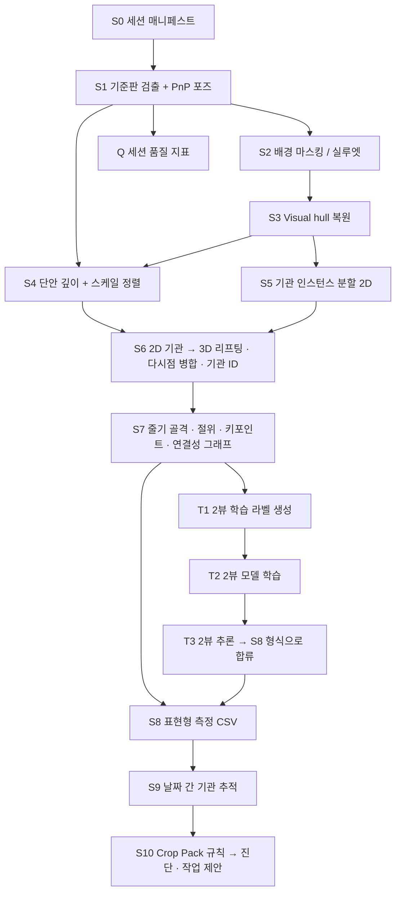

# 토마토 3D 표현체 시스템 — 설계 리뷰

- 작성일: 2026-09-15
- 대상 브리프: `TOMATO_3D_PHENOTYPING_CLAUDE_2026-09-15.md`
- 상태: 설계 검토 결과 + 결정 대기 목록. 구현 착수 아님.
- 짝 문서: `handoff/TOMATO_3D_PHENOTYPING_ALGORITHM_SKELETON_2026-09-15.md` (영문, 알고리즘 틀)

---

## 1. 확정 / 가정 / 미결정 분리

### 1.1 확정 (사용자 지시)

| # | 항목 | 내용 |
|---|---|---|
| C1 | 작물 | 드워프(왜성) 방울토마토, 실내 선반 + LED. 홈팜 애드온 범위 그대로 |
| C2 | 촬영 | 바둑판 형태 기준판 위에 식물 배치 |
| C3 | 뷰 | 상면 1뷰 + 측면 8뷰 |
| C4 | 카메라 | **1대, 고정 위치** |
| C5 | 깊이 | RGB 다시점 복원 + 단안 깊이 추정 보조 |
| C6 | 산출 | 키포인트 → 적엽·적과 위치 제안, 개화 확인, 영양결핍, 웃자람 판정 |
| C7 | 최종 목표 | 실제 촬영한 상면 1장 + 측면 1장만으로 동일 분석 수행 |
| C8 | 순서 | 워크플로 정리 우선, 구현은 승인 후 |

### 1.2 C4에서 자동으로 따라오는 구조 (검토 결과)

카메라가 1대이고 위치가 고정이면, 측면 8뷰는 **식물 또는 기준판이 회전**해야만 얻어진다.
즉 브리프에 없던 **턴테이블 구성이 사실상 확정**된다. 이로부터 세 가지 귀결이 생기고, 그중 두 개는 설계를 바꾼다.

**(a) 일반 SfM이 실패하는 구성이다 — 1순위 함정**

턴테이블에서는 카메라가 정지하고 배경도 정지한다. COLMAP 같은 표준 SfM은 배경 특징점에 고정되어
"카메라가 움직이지 않았다"고 판단하고, 회전하는 식물을 이상치로 버린다.
→ **대책 1(필수):** 배경을 먼저 마스킹한 뒤 SfM에 넣는다.
→ **대책 2(권장):** 애초에 SfM을 쓰지 않는다. 아래 (b).

**(b) 기준판을 회전판에 고정하면 카메라 포즈를 직접 계산할 수 있다 — 권고**

바둑판이 식물과 함께 돌면, 프레임마다 판의 내부 코너를 검출해 PnP로 카메라 외부 파라미터를
바로 구할 수 있다. SfM 특징점 매칭이 전혀 필요 없다.

- 포즈 오차가 판 검출 정밀도로 상한이 정해지고, 매 프레임 독립이라 실패가 전파되지 않는다.
- 스케일이 판의 실측 사각 크기에서 바로 나온다(미터법 복원).
- 원점·좌표축이 판에 고정되므로 날짜가 달라도 같은 좌표계다 → 시계열 정합이 공짜로 해결된다.

→ **판은 회전판에 고정(식물과 함께 회전)한다.** 판을 바닥에 두고 식물만 돌리면 이 이점이 전부 사라진다.

**(c) 상면 1뷰는 C4와 모순된다 — 결정 필요**

고정 카메라 1대로는 측면과 상면을 동시에 못 찍는다. 선택지는 아래 §6 D3.

### 1.3 가정 (검토를 위해 세운 것, 승인 아님)

- A1. 촬영 1회 = 1개체 = 1세션. 세션 단위로 폴더가 생긴다.
- A2. 촬영 주기는 최소 격일. 시계열 추적의 기본 단위.
- A3. 기존 홈팜 색보정 모듈(구현 완료)을 재사용하므로 컬러차트를 프레임에 함께 넣는다.
- A4. 기관 분할은 기존 SAM+YOLO 자산을 재사용한다.

---

## 2. 기술 타당성 — 지적 사항

### 2.1 45° 간격 8뷰는 MVS(스테레오 매칭)로는 복원되지 않는다

다시점 스테레오는 인접 뷰 시차각이 대략 5~15°일 때 대응점이 잡힌다. 45°는 이 범위 밖이고,
토마토 잎처럼 얇고 텍스처가 빈약하며 광택이 있는 표면은 그마저도 실패율이 높다.
다시점 복원 리뷰에서도 스테레오 계열의 주된 실패 조건으로 "텍스처 정보가 없는 장면"을 명시한다.
실제 다시점 표현체 플랫폼(MVS-Pheno 등)은 회전 플랫폼에 여러 높이 레벨을 조합해
**개체당 수십~수백 장**을 촬영한다.

**그런데 이 구성에서는 뷰 수를 늘리는 비용이 거의 0이다.** 카메라가 고정이고 판이 회전하므로,
8장이든 36장이든 추가 장비 없이 회전 각도만 잘게 나누면 된다. 늘어나는 것은 촬영 시간과 저장 용량뿐이다.

→ **권고: 레퍼런스 3D를 만드는 촬영은 측면 24뷰(15°) 또는 36뷰(10°)로 올린다.**
"9뷰"는 브리프 작성 시점의 편의 가정이지 요구사항이 아니다.
9뷰는 §4의 2뷰 모델 학습에 쓰일 **정답(teacher) 품질**을 결정하는 자리이므로 여기서 아끼면 최종 성능이 상한에 막힌다.

### 2.2 8뷰를 유지해야 한다면 — 실루엣 기반 복원으로 전환

뷰 수를 못 늘리는 경우의 대안은 MVS가 아니라 **Visual Hull(실루엣 교차)**이다.
실루엣은 텍스처가 필요 없어서 8~9뷰로도 외형이 나온다. 대신 잎 사이 오목한 부분은 원리상 복원되지 않는다.

→ 이 한계를 **사용자가 선택한 단안 깊이 보조(C5)가 정확히 메운다.** 두 방식의 역할 분담:

| 성분 | 담당 | 강점 | 한계 |
|---|---|---|---|
| Visual hull | 전체 외형·부피·초장·캐노피 폭 | 텍스처 불필요, 소수 뷰 OK | 오목부 과대추정 |
| 단안 깊이 | 잎면 굴곡, 잎 각도, 기관별 상대 거리 | 표면 디테일 | 절대 스케일 없음 |
| 기준판 | 미터법 스케일, 좌표계 | 정확 | 판이 보여야 함 |

즉 사용자의 C5 선택은 이 촬영 구성에서 타당하다. 다만 **"MVS + 단안 깊이"가 아니라 "Visual hull + 단안 깊이"**로
읽는 것이 맞다. 24뷰 이상으로 올리면 여기에 MVS를 추가해 잎맥 수준 디테일까지 얻을 수 있다.

### 2.3 단안 깊이는 스케일·오프셋을 풀어야 쓸 수 있다

Depth Anything 계열 모델의 출력은 상대(affine-invariant) 깊이다. 실제 거리로 쓰려면
뷰마다 `d_metric = a·d_rel + b`의 두 계수를 추정해야 한다.

→ **해법:** 해당 뷰에서 (i) 기준판 평면 위 점들의 알려진 3D 좌표, (ii) visual hull 표면 점의 투영,
두 집합을 대응점으로 최소자승을 풀어 뷰별 (a, b)를 구한다.
→ **검증 필요:** 판 위에 높이를 아는 기준물(예: 50 mm 블록)을 함께 놓고 복원 높이 오차를 매 세션 기록한다.
이게 없으면 복원 결과가 맞는지 판단할 방법이 없다.

### 2.4 3D 복원 결과는 정답이 아니다

브리프도 지적했듯 복원된 3D는 **검증 전까지는 참조 추정치**다.
초장·엽수 등은 자·캘리퍼스 실측과 대조해야 하고, 세션마다 품질 지표(판 검출 성공 뷰 수,
재투영 오차, 마스크 면적 일관성, 기준물 높이 오차)를 남겨 저품질 세션을 학습에서 제외할 수 있어야 한다.

---

## 3. 농학 타당성 — 이 부분이 가장 크게 바뀐다

드워프(왜성) 토마토는 대부분 **결정형(determinate)**이다. 줄기가 짧고, 화방 수가 유한하며,
정단에 화방이 생기면 신장이 멈춘다. 브리프의 "적엽·적과"를 일반 무한생장 온실 토마토 기준으로
그대로 구현하면 농학적으로 틀린 제안을 하게 된다.

### 3.1 적엽 — "곁순 제거"는 이 품종에서 하면 안 된다

결정형 품종에서 곁순(sucker)을 따면 착과 지점 자체가 줄어 수량이 감소한다.
여러 대학 원예 지도자료가 결정형은 순지르기·곁순 제거를 하지 않거나 최소화하라고 안내한다.

**유효한 적엽 작업은 두 가지뿐이다:**

| 유형 | 대상 | 근거 |
|---|---|---|
| L1. 하엽 제거 | 제1화방 아래 잎 | 통풍 확보, 토양·배지 전염성 병원균의 잎 도달 차단 |
| L2. 노화·이상엽 제거 | 황화·괴사·병반·중복 차광 잎 | 광합성 기여 없음, 병 전파원 |

→ **시스템 출력 재정의:** "적엽 위치"는 **제거 대상 잎 ID + 엽병이 줄기에 붙는 부착점(3D 좌표) + 사유(L1/L2)**.
곁순 위치는 출력하지 않는다.

### 3.2 적과 — 체리형은 통상 적과하지 않는다

대과종에서 하는 화방당 과실 수 제한은 체리형에 그대로 적용되지 않는다.

**유효한 작업:**

| 유형 | 대상 | 근거 |
|---|---|---|
| F1. 불량과 제거 | 기형과, 열과, 병반과, 배꼽썩음과 | 품질 저하 + 병 전파원 |
| F2. 착과 부하 경고 | 화방당 착과 수가 현재 광량(DLI)·엽면적 대비 과다 | 소스-싱크 불균형 → 소과화·당도 저하 |

→ **재정의:** "적과 제안"이 아니라 **"불량과 제거 목록 + 화방별 착과 부하 경고"**.
F2는 임계값이 품종·광량 의존이라 **문헌값으로 확정할 수 없다.** 홈팜 실측으로 채워야 하는 항목이다.

### 3.3 웃자람(도장) — 오히려 이 시스템의 주력 기능

실내 LED 저광 환경의 드워프 토마토에서 도장은 실제로 자주 발생하고, 3D가 잘 잡는 항목이다.

| 지표 | 정의 | 3D가 필요한 이유 |
|---|---|---|
| 절간장 | 인접 절위 간 줄기 경로 길이 | 2D 투영은 기울기 때문에 과소추정 |
| 초장/엽수 비 | 초장 ÷ 전개엽 수 | 절대 초장보다 품종 의존이 적음 |
| 줄기 직경 대비 초장 | 초장 ÷ 기부 줄기 직경 | 연약 도장 판별 |
| 잎 각도 | 엽병의 수평 대비 각 | 상편생장(epinasty) 조기 신호 |

→ **원인 귀속은 영상만으로 불가능하다.** 도장은 광량 부족·야간 고온·질소 과다·주야 온도차(DIF) 등이
모두 같은 형태로 나타난다. 홈팜 애드온은 LED 스케줄과 센서 로그를 갖고 있으므로,
**영상 지표 + 환경 로그를 함께 넣어야** "도장 발생 + 원인 후보"까지 낼 수 있다. 영상 단독은 "도장 발생"까지만.

### 3.4 영양결핍 — RGB 단독 진단은 하지 않는다. 다만 3D가 실제로 기여한다

원소별 시각 증상은 서로 겹치고 조명·품종에 따라 달라져, RGB만으로 원소를 특정하는 것은 신뢰할 수 없다.
**그러나 결핍 부위의 절위(node position)는 강한 판별 정보다:**

| 이동성 | 원소 | 증상 발현 부위 |
|---|---|---|
| 이동성 | N, P, K, Mg | **하위 절위(오래된 잎)부터** |
| 비이동성 | Ca, Fe, B, S, Mn | **상위 절위(신엽)부터** |

이 "어느 절위의 잎인가"가 바로 §4의 절위 그래프가 주는 값이고, 2D 사진 한 장으로는 안정적으로 못 얻는다.

→ **출력 재정의:** 원소명을 단정하지 않는다.
`{증상 유형, 발현 절위 범위, 이동성 구분, 원소 후보 집합, 신뢰도, 권고 조치}` 형태로 내고,
권고 조치는 "EC·pH·배양액 조성 확인"처럼 홈팜에서 실제로 실행 가능한 것으로 한정한다.
홈팜 EC 센서 로그와 교차해야 신뢰도가 올라간다.

**촬영 한계 명시:** 배꼽썩음과는 과실 **하단(꽃자리)**에 나타난다. 측면·상면 뷰에서는 자주 가려진다.
이 증상은 현재 촬영 구성으로 탐지 보장이 안 된다는 것을 스펙에 남겨야 한다.

### 3.5 개화 확인

"개화"의 정의부터 고정해야 한다. 권고: **화판이 전개되어 정면에서 노란 화관이 보이는 상태(anthesis)**.
봉오리(bud)·수정 후 화판 탈락(post-anthesis)과 구분한다.
출력은 `첫 관측 개화일`이며, 이는 **실제 개화일이 아니라 관측일**이다. 촬영 주기(A2)만큼의 오차를 항상 함께 기록한다.

---

## 4. 재정리된 파이프라인



브리프 원안과의 차이:
- SfM 제거, 기준판 PnP로 대체 (§1.2b)
- MVS → Visual hull + 단안 깊이 (§2.2)
- 키포인트 추출 전에 **절위 그래프**를 명시적 단계로 승격 (§3.4가 여기 의존)
- 세션 품질 지표(Q)를 독립 산출물로 분리

---

## 5. 2뷰 전환 아키텍처 — 제안

브리프가 Claude에게 결정을 위임한 항목이다. **완전 3D 복원을 목표로 하지 않는다.**

### 5.1 왜 복원이 아닌가
2장(상면 1 + 측면 1)은 원리적으로 visual hull이 성립하지 않는다(뷰가 너무 적어 hull이 실제 형상을 전혀 제약하지 못함).
2뷰에서 완전 3D를 만들려는 시도는 사실상 학습된 사전지식으로 환각하는 것이고, 그 환각을 다시 측정에 쓰면 오차를 추적할 수 없다.

### 5.2 제안 구조 — 다뷰 레퍼런스를 교사로 쓰는 증류

```
[상면 1 + 측면 1]
   ├─ 기관 인스턴스 분할 + 2D 키포인트 + 절위 그래프 예측
   │     ← 라벨: 다뷰 3D를 2뷰 시점으로 투영해 자동 생성 (가려진 기관 포함)
   ├─ 단안 깊이 → 기관별 부분 3D (기준판으로 스케일 고정)
   └─ 표현형 회귀 헤드 → 초장 · 절간장 · 엽수 · 엽면적 · 화방별 과실수 + 불확실도
         ← 타깃: 다뷰 세션의 S8 측정값
```

**이 구조가 단순 2D 파이프라인보다 나은 이유(핵심 논거):**
다뷰 3D는 **가려진 기관의 정답을 알고 있다.** 따라서 2뷰에서 "보이는 것"만이 아니라
"보이지 않는 것이 얼마나 있는가"를 학습시킬 수 있다. 엽수·과실수처럼 가림에 지배되는 항목에서
이 차이가 전부다. 이것이 9뷰(→24뷰) 촬영에 투자하는 유일하고 충분한 이유다.

### 5.3 반드시 지킬 것
- 가려진 기관은 `observed / inferred / unknown`으로 상태를 구분해 출력한다.
- 불확실도가 임계 초과면 결과를 내지 않고 **재촬영 요청**을 낸다.
- 검증은 렌더링한 2뷰가 아니라 **실제 촬영한 2뷰**로 한다. 렌더 2뷰는 개발 중 디버깅용으로만.
- 분할 기준은 세션이 아니라 **개체(plant_id)**. 같은 개체의 모든 날짜·모든 뷰는 같은 split.
  (브리프가 경고한 정보 누수의 정확한 지점)

---

## 6. 결정 대기 목록

> **2026-09-15 갱신:** D1·D3·D4·D6·D10은 확정되었고, 확정 사양은
> `docs/파일럿_촬영_프로토콜_2026-09-15.md`에 있다. 아래 표는 결정 시점의 기록으로 남긴다.
> D11(농학 규칙·임계값)은 사용자 담당으로 확정.


우선순위 순. D1~D4는 촬영 시작 전에 정해져야 한다.

| # | 결정 항목 | 선택지 | 권고 |
|---|---|---|---|
| **D1** | 기준판 위치 | (a) 회전판에 고정 — 식물과 함께 회전 / (b) 바닥 고정 | **(a)**. §1.2b의 이점 전부가 여기 달림 |
| **D2** | 측면 뷰 수 | 8(45°) / 24(15°) / 36(10°) | **24 이상**. 비용 증가 없음. 8이면 §2.2 실루엣 전용으로 한정 |
| **D3** | 상면 뷰 획득 | (a) 측면 촬영 후 카메라를 상단 지그로 1회 이동 / (b) 상단 전용 2대째 카메라 / (c) 45° 거울 | **(a)**. C4 유지하면서 가장 단순. 판이 보이므로 좌표계 자동 정합 |
| **D4** | 스케일 검증 기준물 | 판 위 고정 높이 블록 포함 여부 | **포함**. 없으면 복원 정확도 측정 불가 |
| D5 | 컬러차트 | 프레임 내 포함 / 세션당 1회 별도 촬영 | 포함 (기존 색보정 모듈 재사용) |
| D6 | 판 규격 | 사각 변 길이, 내부 코너 수, 재질 | 코너 수 ≥ 9×6, 무광 재질. 실측 후 JSON에 고정 |
| D7 | 촬영 주기 | 일 1회 / 격일 / 주 2회 | 개화·착과 시기는 최소 격일 (§3.5 관측 오차) |
| D8 | 개체 수·기간 | ? | 2뷰 학습에 필요한 최소 세션 수를 역산해야 결정 가능 |
| D9 | 기관 분할 라벨 | 기존 YOLO 가중치 전용 / 신규 라벨링 수량 / 라벨러 | 기관 종류가 늘어나므로(화방·꽃·엽병) 신규 라벨 필요 |
| D10 | 환경 로그 연동 | 홈팜 EC·온습도·LED 스케줄을 파이프라인 입력으로 넣을지 | **넣는다**. §3.3·§3.4의 신뢰도가 여기 의존 |
| D11 | Crop Pack 임계값 출처 | 문헌값 / 홈팜 실측 / 혼합 | 혼합. 항목별 `confidence`와 `source` 필드 필수 |
| D12 | "위치" 정의 | 기관 ID 수준 / 부착점 좌표 / 절단점 좌표 | **부착점 좌표까지**. 절단 궤적은 요구사항 아님 |

---

## 7. 기존 홈팜 자산과의 관계

| 기존 자산 | 이 워크플로에서 | 조치 |
|---|---|---|
| 색보정 모듈 (구현 완료) | S0/S2 전처리에 그대로 투입 | 재사용. 실제 캘리브레이션 검증은 여전히 미결 |
| 과실 특징 추출 · 직경→질량 (구현 완료) | S8 과실 측정에 연결. 단 2D 직경 → **3D 직경**으로 입력이 바뀜 | 인터페이스 확인 필요 |
| 수확시기 예측 RNN | S9 시계열 출력이 입력 피처가 됨 | 연결점 설계 필요 (별도 문서) |
| SAM+YOLO 잎 분할 | S5 | 기관 클래스 확장 필요 (D9) |
| 겹침(중첩) 미해결 과제 | **이 워크플로가 정면으로 푸는 문제** | 다시점 + 3D 리프팅이 대안 |

---

## 8. 검증 계획 (수치 기준은 미승인)

**8.1 파일럿 (구현 전 필수)**
개체 3주씩, D2의 두 조건(8뷰 vs 24뷰)으로 같은 개체를 연속 촬영해 복원 품질을 실측한다.
측정: 기준물 높이 오차, 초장 오차(자 실측 대비), 엽수 일치율, 판 검출 성공 뷰 비율.
이 결과 없이는 D2를 문헌만으로 확정하지 않는다.

**8.2 평가 항목** (브리프 §9 유지)
키포인트 위치 오차 · 연결성 정확도 · 표현형 오차 · 개화 탐지 · 도장 판정 · 제안 기관 일치도 · 가림별 실패율.

**8.3 수용 기준**
현재 승인된 수치 없음. 8.1 파일럿 결과가 나온 뒤 항목별로 제안한다.

---

## 9. 다음 단계

1. D1~D4 결정 → 파일럿 촬영 프로토콜 확정
2. 파일럿 실행 → 복원 품질 실측
3. D2 확정 → `handoff/` 1단계(촬영·캘리브레이션 모듈) 영문 핸드오프 작성
4. Crop Pack 스키마 확장안 별도 문서
